<a href="https://mdtarek.dev">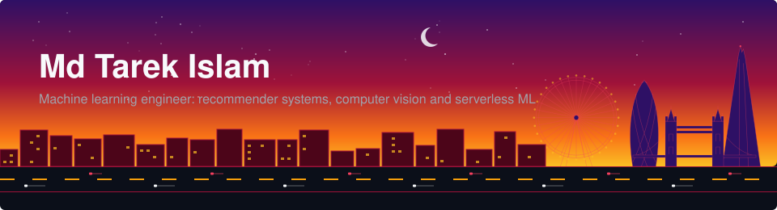</a>

<p align="center">
<a href="https://mdtarek.dev"></a>
<a href="https://www.linkedin.com/in/mdtarek-islam/"></a>
<a href="https://g.dev/mdtarek"></a>
<a href="https://github.com/mdtarek-islam"></a>
</p>

I am a machine learning engineer. I build recommender systems and computer vision pipelines, and I design serverless ML services on AWS Lambda. This page follows that route, from study and work to the projects and the weekly commits.

## The route so far

<p align="center">
  
</p>

The road starts with a BSc in Computer Science at the University of Warwick. Next comes an internship as a software engineer at Infosys. After that, an MSc in AI and Data Analytics at Loughborough University London. At Software Academy I have worked as a software tutor, a taster leader and the AI and ML lead.

## Destinations

Each card links to its repository. A result appears only where a measured number exists, with a note on its source.

<table>
<tr>
<td width="50%" valign="top">
<a href="https://github.com/mdtarek-islam/watermark-detector"></a>
<h3><a href="https://github.com/mdtarek-islam/watermark-detector">Watermark Detector</a></h3>
<sub>Oct 2024</sub>
<p>A Siamese CNN detects watermarks in images. The Unsplash API collected the training dataset automatically.</p>
<p><sub><b>Stack:</b> Python, TensorFlow, Keras, PIL, Unsplash API</sub></p>
<p><b>Result:</b> 87% detection accuracy on a 450-image dataset, batch size 32, 20 epochs.<br /><sub>Measured in the Oct 2024 project.</sub></p>
</td>
<td width="50%" valign="top">
<a href="https://github.com/mdtarek-islam/luminovels"></a>
<h3><a href="https://github.com/mdtarek-islam/luminovels">LumiNovels</a></h3>
<sub>Oct 2023 to Apr 2024</sub>
<p>A 2-layer multi-class neural network in Java gives personalised reading recommendations. NLP feature selection reduces genre overlap.</p>
<p><sub><b>Stack:</b> Java, Multi-Class Neural Network, NLP, Content-Based Filtering, REST APIs</sub></p>
<p><b>Result:</b> 2-layer classifier, 10,000+ samples pre-processed via REST APIs.<br /><sub>Owner-reported from the original Oct 2023 to Apr 2024 project. See the project report PDFs in the repo.</sub></p>
</td>
</tr>
<tr>
<td width="50%" valign="top">
<a href="https://github.com/mdtarek-islam/recommal"></a>
<h3><a href="https://github.com/mdtarek-islam/recommal">Recommal</a></h3>
<sub>Oct 2026</sub>
<p>A cross-domain recommender. Pick an anime and get video games, or pick a game and get anime. A two-tower Siamese encoder maps both catalogues into one vector space.</p>
<p><sub><b>Stack:</b> Python, PyTorch, Sentence-Transformers, Streamlit, Supabase PostgreSQL, Docker, Render</sub></p>
<p><b>Result:</b> no figure quoted here.<br /><sub>See artefacts/metrics.json in the repo for measured results.</sub></p>
</td>
<td width="50%" valign="top">
<a href="https://github.com/mdtarek-islam/biomecha-rag"></a>
<h3><a href="https://github.com/mdtarek-islam/biomecha-rag">Biomechanical Sports Analytics Hybrid RAG Engine</a></h3>
<sub>2026</sub>
<p>A split-compute RAG assistant for sports biometrics, such as badminton smash mechanics and swimming hydrodynamics. Dense vectors and sparse indexing feed a cross-encoder reranker before generation.</p>
<p><sub><b>Stack:</b> Python, LangChain, Pinecone, Hugging Face (Mistral-7B, BGE), AWS Lambda, API Gateway, Terraform, GitHub Actions</sub></p>
<p><b>Result:</b> no measured metrics yet.</p>
</td>
</tr>
<tr>
<td width="50%" valign="top">
<a href="https://github.com/mdtarek-islam/serverless-tel-parser"></a>
<h3><a href="https://github.com/mdtarek-islam/serverless-tel-parser">Serverless Hero-Shooter Telemetry Parser</a></h3>
<sub>2026</sub>
<p>A serverless computer vision pipeline parses Overwatch and Marvel Rivals scoreboard screenshots. ONNX Runtime runs in a Docker image on AWS Lambda.</p>
<p><sub><b>Stack:</b> Python, PyTorch, ONNX Runtime, Docker, AWS Lambda, API Gateway, DynamoDB, Terraform</sub></p>
<p><b>Result:</b> no measured metrics yet.<br /><sub>The cold start under 200 ms is a design target, not a measurement.</sub></p>
</td>
<td width="50%" valign="top"></td>
</tr>
</table>

### More projects

- [ReinforcedLN](https://github.com/mdtarek-islam/reinforced-ln): a light novel recommender that learns online from Good or Bad feedback. SBERT embeddings feed an epsilon-greedy neural policy.
- [ML Stock Market Analysis](https://github.com/mdtarek-islam/ml-stock-market-analysis): predicts S&P 500 close price, volume and direction 7 trading days ahead. LSTM, logistic regression and random forest models use 2021 to 2024 data.
- [Rental OOP](https://github.com/mdtarek-islam/rental-oop): an object-oriented car rental system in Python. It meets all 22 requirements in its specification and has 45 tests.
- [Comedian Timetable](https://github.com/mdtarek-islam/comedian-timetable): a constraint solver that builds a weekly comedy club timetable. Backtracking with MRV and LCV finds legal schedules, and simulated annealing lowers their cost.
- [Certifications Vault](https://github.com/mdtarek-islam/certifications-vault): a dated index of 11 course certificates in cloud, machine learning and generative AI, completed in October 2026.

## Public project showcase

This grid rebuilds each day from the public repositories of this account. Each card shows the name, a short description, the main language and the star count.

<!-- SHOWCASE:START -->
<table>
<tr>
<td width="50%" valign="top">
<a href="https://github.com/mdtarek-islam/biomecha-rag">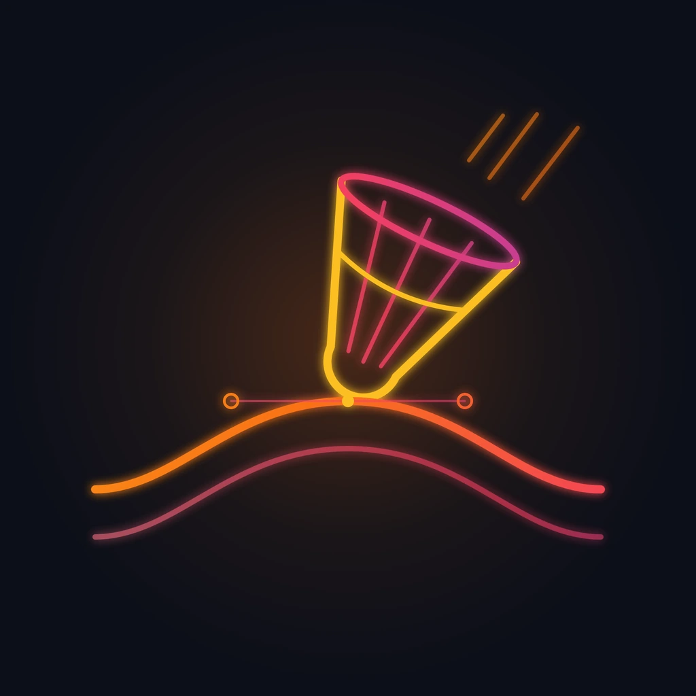</a>
<h3><a href="https://github.com/mdtarek-islam/biomecha-rag">biomecha-rag</a></h3>
<p><sub>Python, 0 stars</sub></p>
</td>
<td width="50%" valign="top">
<a href="https://github.com/mdtarek-islam/certifications-vault"></a>
<h3><a href="https://github.com/mdtarek-islam/certifications-vault">certifications-vault</a></h3>
<p><sub>Python, 0 stars</sub></p>
</td>
</tr>
<tr>
<td width="50%" valign="top">
<a href="https://github.com/mdtarek-islam/comedian-timetable"></a>
<h3><a href="https://github.com/mdtarek-islam/comedian-timetable">comedian-timetable</a></h3>
<p><sub>Python, 0 stars</sub></p>
</td>
<td width="50%" valign="top">
<a href="https://github.com/mdtarek-islam/luminovels"></a>
<h3><a href="https://github.com/mdtarek-islam/luminovels">luminovels</a></h3>
<p><sub>Java, 0 stars</sub></p>
</td>
</tr>
<tr>
<td width="50%" valign="top">
<a href="https://github.com/mdtarek-islam/ml-stock-market-analysis">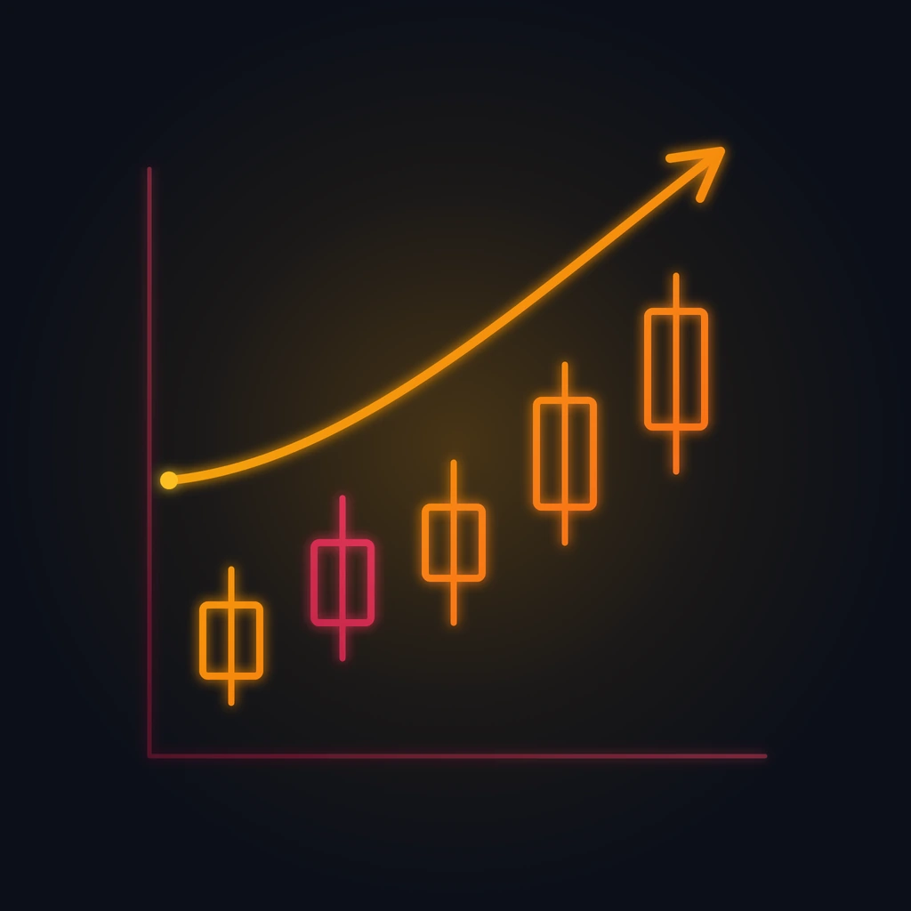</a>
<h3><a href="https://github.com/mdtarek-islam/ml-stock-market-analysis">ml-stock-market-analysis</a></h3>
<p><sub>Python, 0 stars</sub></p>
</td>
<td width="50%" valign="top">
<a href="https://github.com/mdtarek-islam/recommal">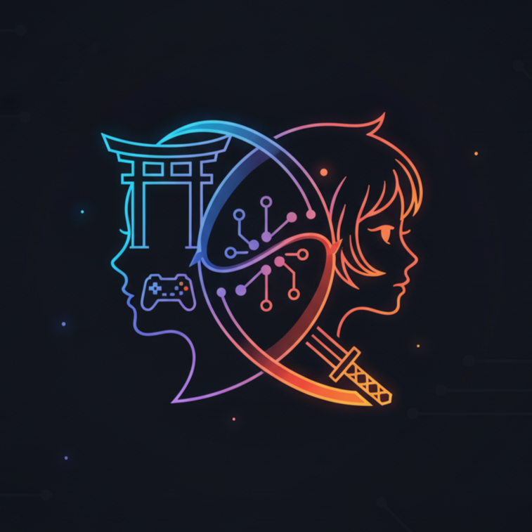</a>
<h3><a href="https://github.com/mdtarek-islam/recommal">recommal</a></h3>
<p><sub>Python, 0 stars</sub></p>
</td>
</tr>
<tr>
<td width="50%" valign="top">
<a href="https://github.com/mdtarek-islam/reinforced-ln">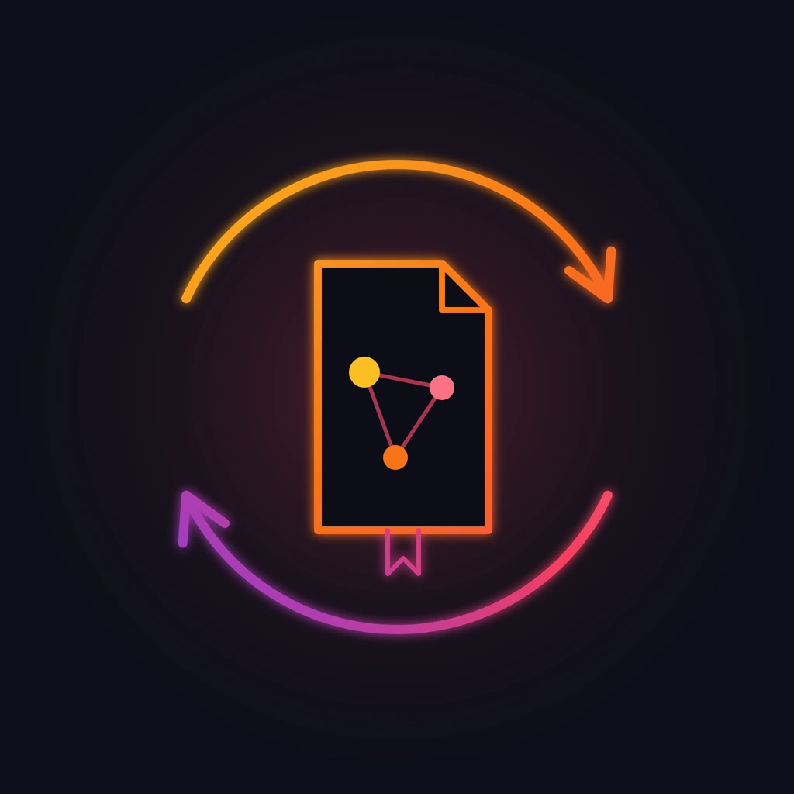</a>
<h3><a href="https://github.com/mdtarek-islam/reinforced-ln">reinforced-ln</a></h3>
<p><sub>Python, 0 stars</sub></p>
</td>
<td width="50%" valign="top">
<a href="https://github.com/mdtarek-islam/rental-oop">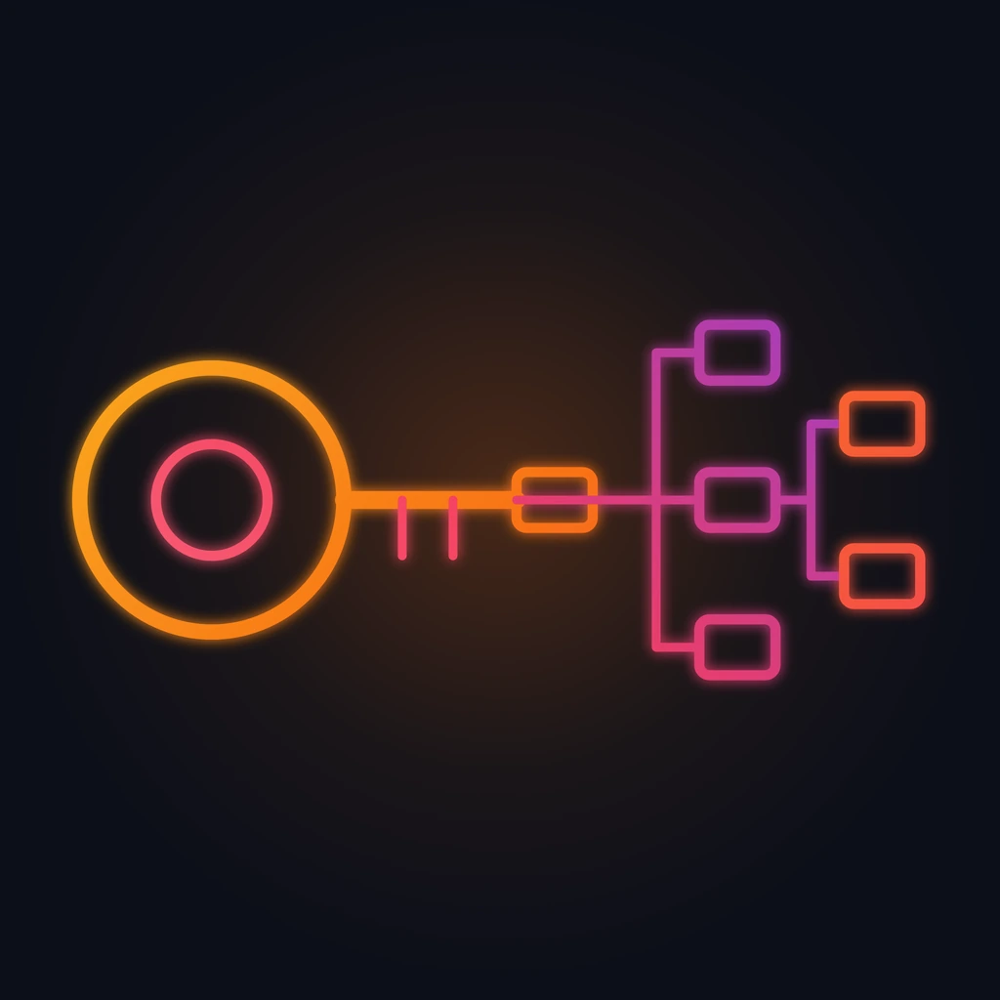</a>
<h3><a href="https://github.com/mdtarek-islam/rental-oop">rental-oop</a></h3>
<p><sub>Python, 0 stars</sub></p>
</td>
</tr>
<tr>
<td width="50%" valign="top">
<a href="https://github.com/mdtarek-islam/serverless-tel-parser">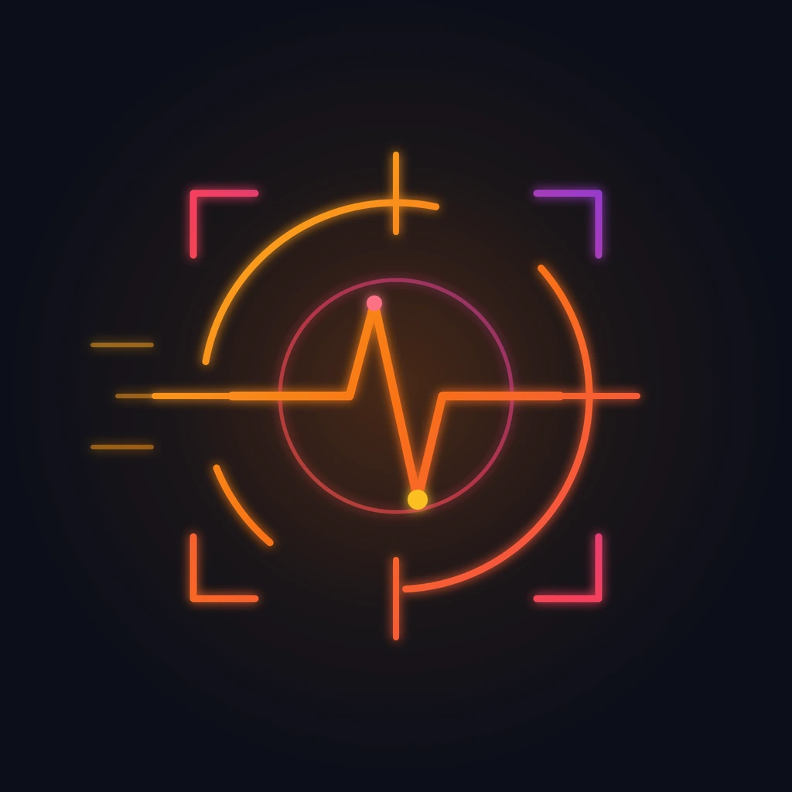</a>
<h3><a href="https://github.com/mdtarek-islam/serverless-tel-parser">serverless-tel-parser</a></h3>
<p><sub>Python, 0 stars</sub></p>
</td>
<td width="50%" valign="top">
<a href="https://github.com/mdtarek-islam/watermark-detector">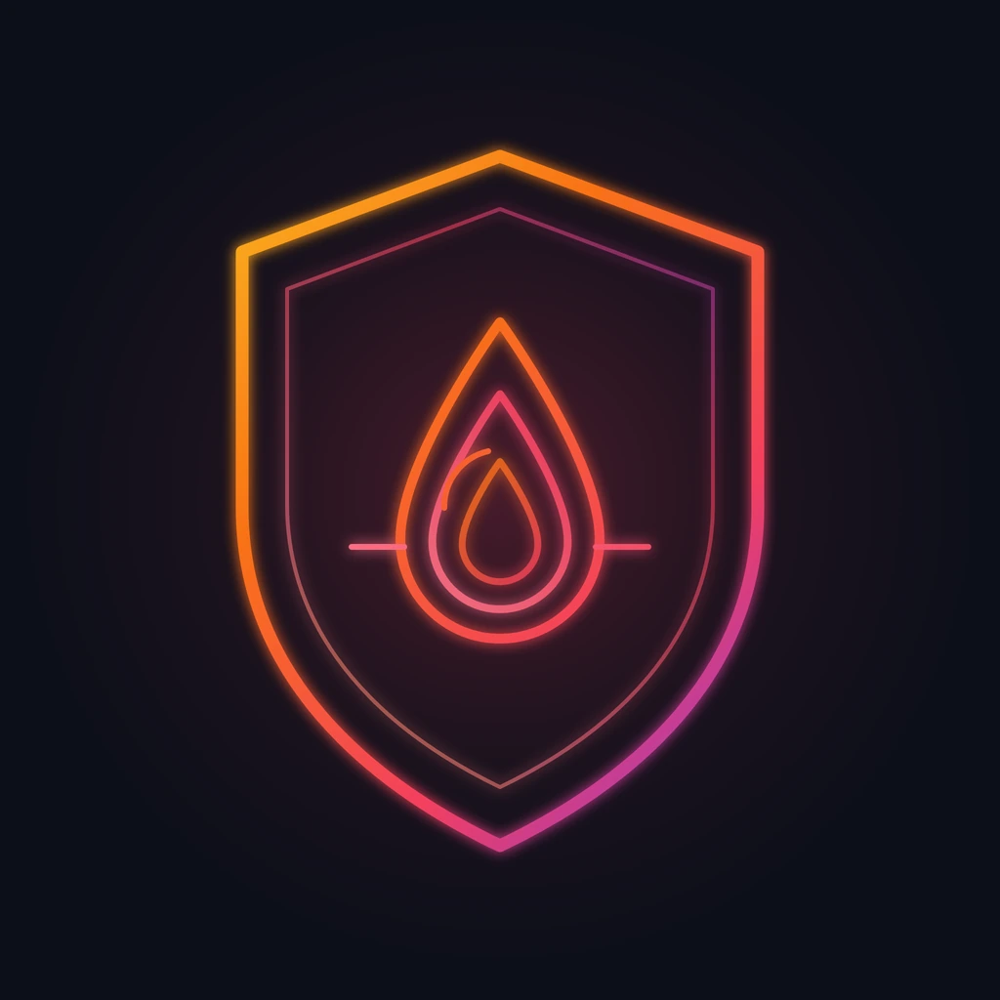</a>
<h3><a href="https://github.com/mdtarek-islam/watermark-detector">watermark-detector</a></h3>
<p><sub>Python, 0 stars</sub></p>
</td>
</tr>
</table>
<!-- SHOWCASE:END -->

## Under the bonnet

<p align="center">
  
</p>

## Live from the Embankment

<p align="center">
  
</p>

Each building is one week of GitHub contributions over the last 52 weeks. Its height follows the weekly total. The 7 windows are the days, with Sunday at the top. Brighter windows mark busier days, on quartile levels like the GitHub calendar. A scheduled workflow redraws the scene each day through [`scripts/portfolio_sync.py`](./scripts/portfolio_sync.py), which calls [`scripts/generate_skyline.py`](./scripts/generate_skyline.py). Until the first run, the graph shows a zero-data baseline.

The graph counts commits, code reviews, pull requests, issues and private contributions. [`docs/MAINTENANCE.md`](./docs/MAINTENANCE.md) explains each figure.

## Certifications

[11 course certificates in cloud, machine learning and generative AI](https://github.com/mdtarek-islam/certifications-vault), completed in October 2026.

## Contact

<p align="center">
<a href="https://mdtarek.dev"></a>
<a href="https://www.linkedin.com/in/mdtarek-islam/"></a>
<a href="https://github.com/mdtarek-islam"></a>
<a href="https://g.dev/mdtarek"></a>
<br />
<a href="https://leetcode.com/u/md_tarek_islam/"></a>
<a href="https://www.hackerrank.com/profile/md_tarek_mlearn"></a>
<a href="https://www.geeksforgeeks.org/profile/mdtarekmwny"></a>
</p>

<details>
<summary>About this repository</summary>

#### Overview

This repository holds the GitHub profile page for mdtarek-islam. The page is a README with four SVG scenes, two original badges and a showcase grid that a script keeps current.

#### Architecture

The README embeds the SVG files in [`assets/`](./assets). [`scripts/portfolio_sync.py`](./scripts/portfolio_sync.py) lists the public repositories, downloads their cover images into `assets/covers/` and rewrites the showcase grid. It also reads the GitHub GraphQL contribution calendar and, through [`scripts/generate_skyline.py`](./scripts/generate_skyline.py), writes `assets/london-skyline.svg`.

#### Features

- Animated SVG scenes. Each one stops all motion under `prefers-reduced-motion`.
- A skyline graph that a scheduled workflow redraws each day.
- A showcase grid of public projects, rebuilt each day.
- Unit tests for both scripts, run before every sync.

#### Quick start

```bash
python scripts/generate_skyline.py --offline
python scripts/portfolio_sync.py --offline --dry-run
python -m unittest discover -s scripts -p "test_*.py"
python -m pytest tests
```

The first command writes the zero-data baseline. The second previews a sync from fixtures. The last two run the tests.

#### Configuration

Set `GITHUB_TOKEN` to fetch real data. `portfolio_sync.py` takes `--dry-run`, `--offline`, `--fixtures` and `--root`. `generate_skyline.py` takes `--login` to chart another user, `--output` to change the file and `--input` to render a saved GraphQL response.

#### Usage

[`.github/workflows/daily-portfolio-sync.yml`](./.github/workflows/daily-portfolio-sync.yml) runs each day at 00:00 UTC. It tests the scripts, runs the sync and commits changed files to `main`.

#### Licence and contribution

MIT, see [`LICENSE`](./LICENSE). Open an issue to report a broken link or a wrong fact.

#### Maintenance status

Maintained. The workflow refreshes the skyline each day, and the owner edits the rest by hand. Follow [`docs/MAINTENANCE.md`](./docs/MAINTENANCE.md) for the schedule, secrets and yearly token renewal.

</details>
